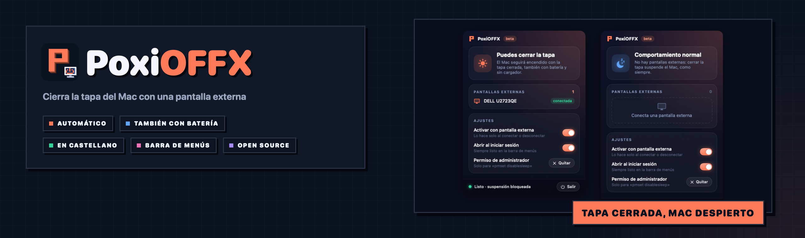
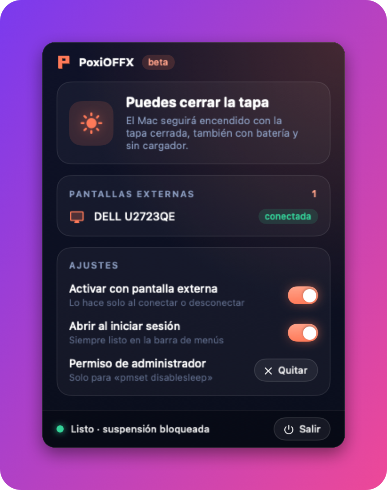
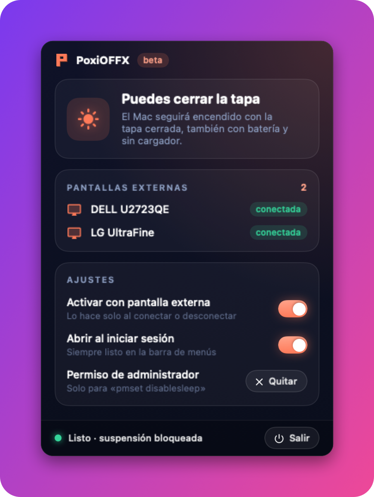
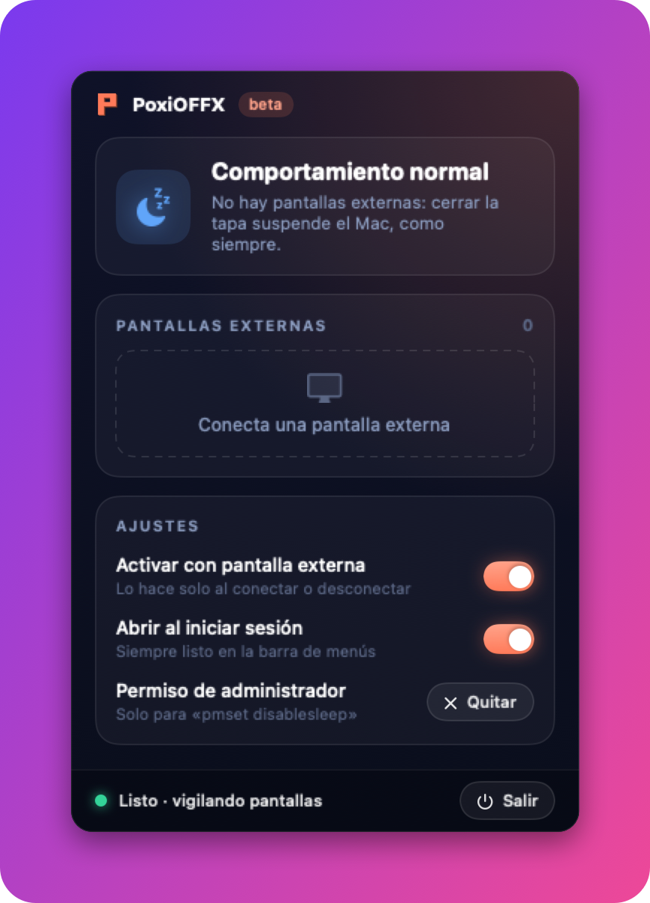
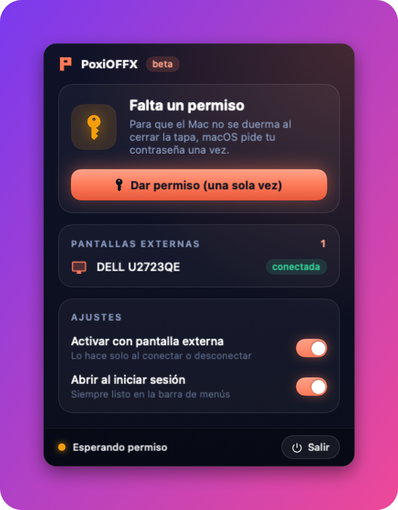

<div align="center">



<br />


**🇪🇸 Español** · [🇬🇧 English](#-english)

### Conecta una pantalla, **cierra la tapa** y el Mac **sigue funcionando**, también con batería.

PoxiOFFX vive en la barra de menús y vigila tus pantallas. Si hay una pantalla externa,
cerrar la tapa ya no suspende el Mac. Cuando la desconectas, todo vuelve a ser como siempre.

</div>

---

## 🎯 Qué es

macOS solo deja usar el Mac con la tapa cerrada si está **enchufado al cargador** y tiene teclado y ratón
conectados. Con batería, o con un teclado y ratón compartidos por red (como **Deskflow**), cerrar la tapa lo
duerme sí o sí.

PoxiOFFX lo arregla solo:

- 🖥️ **Conectas una pantalla externa** → bloquea la suspensión. Ya puedes cerrar la tapa.
- 🔌 **La desconectas** → espera 4 segundos (por si el monitor solo ha parpadeado) y devuelve macOS a la normalidad.
  Si la tapa ya estaba cerrada, duerme el Mac en el acto, como haría macOS.
- 🖥️🖥️ Funciona igual con **dos o más pantallas**.

## 📸 Así se ve

| | |
|:---:|:---:|
|  |  |
| ☀️ Con una pantalla: puedes cerrar la tapa | 🖥️🖥️ Con dos pantallas, igual |
|  |  |
| 🌙 Sin pantallas: comportamiento normal | 🔑 La primera vez pide permiso |

<sub>Capturas con datos de ejemplo.</sub>

## 📥 Descarga

| Archivo | Para qué |
|---|---|
| [`PoxiOFFX-1.0.0.dmg`](https://github.com/PoxiiTV/PoxiOFFX/releases/latest) | Abre el `.dmg` y arrastra PoxiOFFX a **Aplicaciones** |

> Como la app aún no está firmada por Apple, macOS la bloquea la primera vez. Ábrela, cierra el aviso y ve a
> **Ajustes del Sistema → Privacidad y seguridad → Abrir igualmente**.

---

## 🌟 Lo que lo hace distinto

| | |
|---|---|
| 🔋 **También con batería** | No hace falta el cargador: es justo el caso que macOS no permite. |
| 🤖 **Automático** | Ni botones ni recordar nada: conectar y desconectar es todo lo que haces. |
| 🛡️ **Vuelve a la normalidad siempre** | Al desconectar la pantalla, al poner la app en pausa y al salir. |
| ⏱️ **Sin falsos sustos** | Si el monitor desaparece un instante (al dormirse o cambiar de resolución), no duerme el Mac. |
| 🔑 **Permiso mínimo** | Solo puede ejecutar `pmset -a disablesleep 1` y `0`. Nada más. Se quita con un botón. |
| 🪶 **Ligera** | Sin bucles: reacciona a los avisos de macOS cuando cambian las pantallas. |

## 🚀 Cómo se usa

1. Abre PoxiOFFX. Aparece un icono en la barra de menús (💻 normal, 🖥️ con pantalla externa).
2. La primera vez, pulsa **Dar permiso (una sola vez)** y escribe tu contraseña.
3. Activa **Abrir al iniciar sesión** para no tener que acordarte.
4. Conecta la pantalla y cierra la tapa. Sigue usando el Mac con tu teclado y ratón (o con Deskflow).

## 🪶 Consumo

Medido en un MacBook Pro M5 con macOS Tahoe: **~48 MB de RAM** y **0 % de CPU** en reposo
(no vigila nada en bucle: macOS le avisa cuando cambian las pantallas).

## ⚠️ Avisos

- **Calor:** con la tapa cerrada el Mac se ventila peor. No lo metas en una mochila con la pantalla
  conectada… y si lo desconectas, PoxiOFFX lo duerme.
- **Mientras haya pantalla externa, el Mac no se duerme nunca solo** (tampoco por inactividad). La pantalla sí
  se apaga cuando toca.
- **Batería:** con batería y la tapa cerrada sigue gastando. Vigila el nivel.
- **Si la app se cierra de golpe** con una pantalla conectada, la suspensión queda bloqueada hasta que la vuelvas a
  abrir (se arregla sola al arrancar) o ejecutes `sudo pmset -a disablesleep 0`.
- **Cómo funciona por dentro:** usa `pmset -a disablesleep`, el ajuste de macOS que impide suspender. Como necesita
  permisos de administrador, la app instala una regla en `/etc/sudoers.d/poxioffx` que permite **solo esos dos
  comandos** sin contraseña. El botón **Quitar** la borra.

---

## 🔧 Compilar

Requisitos: macOS 14+, Apple Silicon y Command Line Tools (no hace falta Xcode).

```bash
./test.sh                     # tests de la lógica
./make-app.sh                 # build/PoxiOFFX.app
./make-dmg.sh                 # build/PoxiOFFX-1.0.0.dmg
./scripts/make-assets.sh      # icono, capturas y banner del README
```

Útiles: `PoxiOFFX --estado` (qué ve: pantallas, tapa, bloqueo y permiso) y `PoxiOFFX --snapshot <carpeta>`.

### 🗃️ Estructura

```
PoxiOFFX/
├── Sources/
│   ├── PoxiOFFXCore/Reglas.swift   lógica pura: cuándo bloquear, pmset, regla de sudoers
│   └── PoxiOFFX/
│       ├── main.swift              barra de menús, capturas y arranque
│       ├── Vigilante.swift         vigila pantallas y aplica el bloqueo
│       ├── Energia.swift           pantallas, tapa, pmset y permiso
│       └── Vista.swift             interfaz con el estilo Poxi
├── Tests/PoxiOFFXCoreTests/        tests de la lógica
├── scripts/                        icono, capturas y banner
└── make-app.sh · make-dmg.sh · test.sh
```

## 🙏 Gracias a

- `pmset` de Apple, que hace el trabajo de verdad.
- **Deskflow**, por la idea de usar el Mac con la tapa cerrada.

## 📜 Licencia

[GPL-3.0](LICENSE) · Alexis Juárez ([PoxiiTV](https://github.com/PoxiiTV)) · [tools.alexiis.dev](https://tools.alexiis.dev)

---

## 🇬🇧 English

### What it is

macOS only lets you use a Mac with the lid closed when it is **plugged into power** with a keyboard and mouse
attached. On battery, or with a keyboard and mouse shared over the network (like **Deskflow**), closing the lid
always puts it to sleep. **PoxiOFFX** lives in the menu bar: when an external display is connected it blocks
sleep, so you can close the lid. When you unplug the display, it restores normal behaviour (and puts the Mac to
sleep right away if the lid is already closed). Works with two or more displays too.

### Download

Get [`PoxiOFFX-1.0.0.dmg`](https://github.com/PoxiiTV/PoxiOFFX/releases/latest) and drag the app to
**Applications**. The app is not signed by Apple yet: open it, close the warning and go to
**System Settings → Privacy & Security → Open Anyway**.

### Highlights

- 🔋 **Works on battery**, the case macOS does not allow.
- 🤖 **Automatic**: plug and unplug, that's it.
- 🛡️ **Always restores** normal sleep when unplugging, pausing or quitting.
- 🔑 **Minimal permission**: a sudoers rule that only allows `pmset -a disablesleep 1` and `0`, removable with one click.
- 🪶 **Light**: ~48 MB RAM, 0 % CPU when idle.

### Notices

- With the lid closed the Mac cools worse: do not put it in a bag with a display connected.
- While an external display is connected, the Mac never idle-sleeps.
- If the app crashes with a display connected, sleep stays blocked until you reopen it or run
  `sudo pmset -a disablesleep 0`.

### License

[GPL-3.0](LICENSE)
